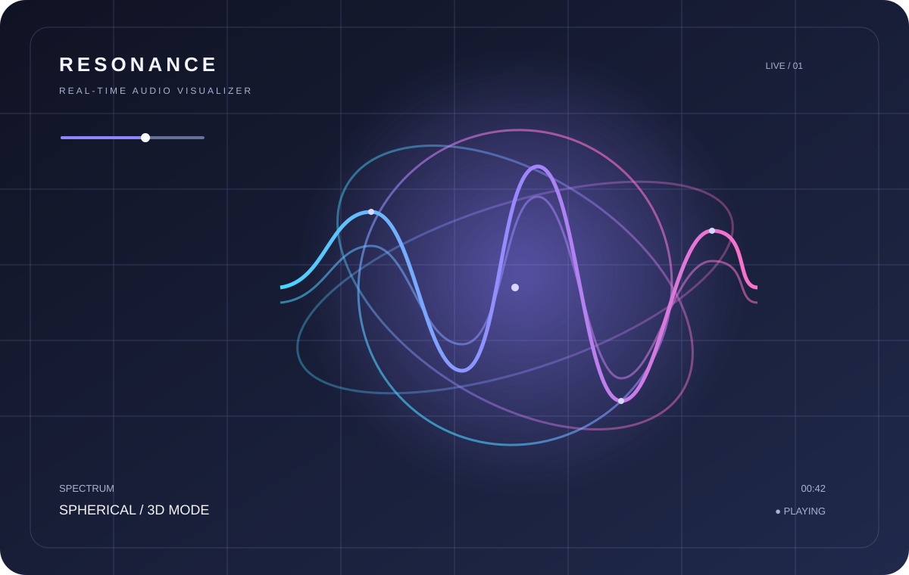

<div align="center">

# Static Projects

### A collection of ideas, experiments and small digital products.

**By [Parag Jyoti Das](https://github.com/JyotiInHex)** · Frontend development · UI/UX · Creative coding

[](https://jyotiinhex.github.io/static_projects/)
[](https://github.com/JyotiInHex/static_projects)

</div>

---

## About this collection

This repository is a home for independent web projects, frontend experiments and interactive interfaces. Each project lives in its own folder, with its own code and purpose.

The goal is simple: build useful things, explore what the browser can do, and keep every experiment easy to discover, run and improve.

## Project gallery

The gallery is powered by a small project registry and is published with GitHub Pages.

**[Browse all projects →](https://jyotiinhex.github.io/static_projects/)**

## Featured project

### [Resonance — 3D Audio Visualizer](./resonance-3d-audio-visualizer/)

A browser-based audio visualizer that turns supported audio input into expressive 3D experiences.

<div align="center">
  <a href="./resonance-3d-audio-visualizer/">
    
  </a>
</div>

**Highlights**
- Six visualization modes: Wave, Bars, Circle, Particles, Sphere and Liquid.
- Local audio-file playback with a playlist.
- Live microphone input.
- Adjustable visualization sensitivity and rendering quality.

**Built with:** HTML · CSS · JavaScript · Three.js · Web Audio API

[**Open live experience →**](https://jyotiinhex.github.io/static_projects/resonance-3d-audio-visualizer/) · [View source](./resonance-3d-audio-visualizer/)

## Repository structure

```text
static_projects/
├── index.html             # Project collection homepage
├── projects.json          # Project metadata and gallery registry
├── favicon.svg            # Site favicon
├── assets/                # Shared visual assets
├── scripts/               # Validation and project tooling
├── src/                   # Build source files
└── project-folder/        # Independent project
    ├── index.html
    ├── README.md
    ├── css/
    ├── js/
    └── assets/
```

Each project should remain self-contained. Shared files belong at the repository root only when multiple projects genuinely use them.

## Add a project

1. Create a descriptive, lowercase folder at the repository root.
2. Add the project's entry page as `<project-folder>/index.html`.
3. Include a project-specific `README.md` with its purpose, features, technologies and run instructions.
4. Add a matching entry to `projects.json` using the existing schema.
5. Keep project-specific styles, scripts and media inside that project folder.
6. Add or update its preview image and public metadata where applicable.

Use relative paths in the registry (for example, `./my-project/`) so the gallery works when hosted from the repository's GitHub Pages subpath.

## Run locally

The homepage loads `projects.json` with `fetch()`, so run the repository through a local HTTP server rather than opening `index.html` directly.

**Python**
```bash
python -m http.server 8000
```

Then open [http://localhost:8000](http://localhost:8000).

## Development

Install the repository dependencies:

```bash
npm install
```

Validate the project registry:

```bash
npm run validate:projects
```

Build the Tailwind stylesheet:

```bash
npm run build
```

The build task validates the registry and compiles the Tailwind source from `src/input.css` into `assets/css/styles.css`.

> **Current homepage note:** The published homepage currently uses the Tailwind CDN for its styling. Keep that reference until a compiled stylesheet has been generated, committed and verified.

## Publishing

The project gallery is published through GitHub Pages:

- **Live gallery:** https://jyotiinhex.github.io/static_projects/
- **Deployment source:** `main` branch, repository root.

When adding or removing public projects, update `projects.json` and the sitemap as needed.

## Project principles

- **Independent:** Each project can be understood and developed on its own.
- **Usable:** Prioritize clear interfaces and practical interactions.
- **Maintainable:** Keep code organized and avoid unnecessary coupling.
- **Discoverable:** Document each project and provide a working preview where possible.
- **Experimental:** Use the collection to learn, test ideas and ship small things.

---

<div align="center">

Made with curiosity by **[Parag Jyoti Das](https://github.com/JyotiInHex)**.

[Project Gallery](https://jyotiinhex.github.io/static_projects/) · [GitHub Profile](https://github.com/JyotiInHex)

</div>
